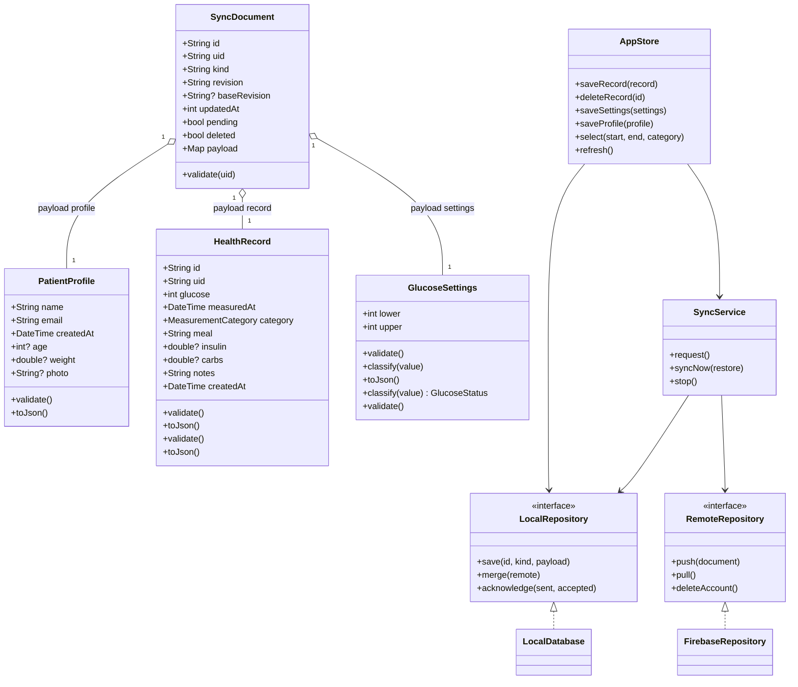

# Arquitetura e modelagem - Unidade II

## Fontes e decisões

Implementação no projeto `glicotrack_dev`, sem recriação do frontend. Fontes: texto de implementação fornecido pelo solicitante, `GlicoTrack.pdf` (inclusive aditivo da Unidade II), enunciado da avaliação e documentos da Unidade I neste repositório. As determinações acadêmicas nos PDFs são requisitos do produto/entrega; não autorizam publicação no Teams, commits em nome da equipe ou implantação em uma conta Firebase.

Esta versão integra o backend somente às telas já desenvolvidas pela equipe. Por definição explícita do escopo do GlicoTrack, não há tela de login, cadastro, recuperação de senha ou logout. O item genérico de login do enunciado não foi adotado nesta versão. A autenticação Firebase permanece automática em segundo plano, reutilizando a sessão persistida ou criando uma sessão anônima na primeira abertura, como a main anterior da equipe. As quatro abas e as telas secundárias existentes são preservadas.

A numeração oficial para rastreabilidade é a de `requisitos.md`, RF01-RF17 e RNF01-RNF21. As apresentações contêm numerações resumidas diferentes. Prevalece a lista completa. O trecho antigo de `estudo-de-caso.md` que sugere ausência de som em ambientes públicos diverge do PDF e de RF06; o alerta sonoro é restrito à hipoglicemia. Quanto ao cálculo de insulina citado no objetivo do estudo de caso, o grupo optou por **registrar apenas a dose aplicada pelo paciente** e **não calcular ou sugerir doses automaticamente**: seguindo as diretrizes da Sociedade Brasileira de Diabetes (SBD) e princípios de segurança clínica, o cálculo de bolus depende de parâmetros individuais prescritos por médico (razão insulina/carboidrato, fator de sensibilidade, insulina ativa e meta glicêmica específica), de modo que automatizá-lo sem prescrição validada ofereceria risco ao paciente. No domínio, o contrato `PrescribedDoseCalculator` foi mantido apenas como ponto de extensão futuro caso o produto evolua com validação médica.

## Camadas

| Camada | Implementação | Responsabilidade |
| --- | --- | --- |
| Domain | `lib/domain/models.dart` | Registro agregado, perfil, metas, validação, classificação e indicadores históricos |
| Domain | `lib/domain/sync_document.dart`, `repositories.dart` | Contratos de persistência/sincronização, revisão e resolução determinística |
| Data | `lib/data/local_database.dart` | SQLite/SQLCipher, transações, fila, conflitos, exclusão e isolamento por UID |
| Data | `firebase_repository.dart`, `sync_service.dart` | Transações Firestore, paginação, sincronização, retentativa e importação |
| Presentation | `lib/presentation/app_store.dart` | Estado Provider, operações usadas pelas telas e atualização após persistência |
| Presentation | `lib/screens/` | Somente telas originais integradas; quatro abas principais preservadas |
| Serviços | `lib/services/` | PDF existente ampliado, CSV e ponte para alerta sonoro nativo |
| Servidor | `functions/` e `firestore.rules` | Exclusão autenticada, trava permanente contra reenvio e validação independente do cliente |

Provider foi escolhido porque a aplicação não tinha gerenciador de estado e `ChangeNotifier` atende à estrutura existente sem alterar a navegação. Firestore foi escolhido pela ausência de banco remoto anterior, transações e organização por UID. `sqflite_sqlcipher` preserva a API SQLite com criptografia nativa Android/iOS; `flutter_secure_storage` protege uma chave aleatória de 256 bits usando os recursos da plataforma. A camada de domínio não importa Flutter ou Firebase.

## Classes e relacionamentos



Insulina e carboidratos são campos opcionais do registro agregado porque essa é a estrutura do formulário aprovado. Criar, editar e excluir uma medição inclui os três valores, sem inventar novas telas ou entidades clínicas. O contrato `PrescribedDoseCalculator` é apenas um ponto de extensão; não tem implementação nem é utilizado para orientar doses.

## SQLite

Banco criptografado `glicotrack.db`, versão inicial 1. Nenhuma versão anterior de banco existia. `onUpgrade` falha explicitamente para versões desconhecidas; futuras alterações devem adicionar migrações incrementais, sem apagar dados.

| Tabela | Chave e campos | Uso |
| --- | --- | --- |
| accounts | `uid` PK, `deletion_pending`, `sync_error` | Sessão de dados, bloqueio persistente e último código de erro sanitizado |
| categories | `id` PK | fasting, beforeMeal, afterMeal, bedtime |
| documents | PK `(uid,id)`; kind, revision, base_revision, updated_at, payload JSON, deleted, pending, measured_at, category | Registros, perfil e configurações em envelopes versionados |
| conflicts | PK `(uid,id,revision)`; document JSON | Versões divergentes preservadas |

`documents.uid` e `conflicts.uid` referenciam `accounts`; `documents.category` referencia `categories`. Chaves estrangeiras e `secure_delete` ativados. Índices por UID/tipo/data/exclusão, UID/categoria/data e UID/pendência. Nenhuma consulta usa interpolação de valores SQL. O estado mantém um snapshot local e aplica filtros na memória; a lista visual utiliza construção preguiçosa. Históricos muito extensos ainda precisam de medição em hardware alvo antes de alegar escalabilidade ilimitada.

A criação da chave é serializada; conexões independentes impedem que o encerramento de uma sessão feche a conexão de outra. O aplicativo verifica `PRAGMA cipher_version` e recusa persistência sem SQLCipher. Testes FFI usam SQLite comum e validam esquema/CRUD, **não** comprovam criptografia. Há teste nativo em `integration_test/encryption_test.dart`.

## Mapeamento Firestore

```text
users/{firebaseAuthUid}/documents/{recordUuid | settings | profile}
  id, uid, kind, revision, baseRevision, updatedAt, deleted
  changedAt: timestamp atribuído pelo servidor
  payload: mapa HealthRecord | GlucoseSettings | PatientProfile
users/{firebaseAuthUid}/conflicts/{id}_{revision}
  mesmo envelope, sem changedAt
deletionRequests/{firebaseAuthUid}
  state: deleting | completed (somente servidor)
```

Datas do payload são inteiros UTC em milissegundos; a apresentação converte para horário local. Metadados de revisão e exclusão pertencem ao envelope, evitando duplicação nos modelos. `pending` existe apenas no SQLite. O cache persistente do SDK Firestore está desativado, para evitar cópia local de saúde fora do SQLCipher.

As regras exigem token do próprio UID, campos/tipos/limites válidos, categoria permitida e `changedAt == request.time`. Perfis exigem e-mail correspondente ao token. Exclusão física e reversão de tombstones são vedadas ao cliente. Arquivos divergentes são privados e imutáveis, mas podem ser reenviados de forma idempotente. Não há acesso público por regra genérica. As regras não substituem autorização em Cloud Functions, que usa exclusivamente o UID do token.

## Sincronização e conflitos

1. `saveRecord` valida e grava em transação SQLite; o sucesso mostrado ao usuário depende apenas dessa gravação.
2. A fila `pending=1` é drenada em segundo plano. UUID é estável e utilizado como ID remoto.
3. Cada envio executa transação Firestore. Revisões iguais não duplicam registros.
4. Alteração causal (`baseRevision` igual à revisão anterior) vence. Alterações concorrentes priorizam exclusão; nas demais, vence a maior revisão lexicográfica (microssegundos lógicos + UUID).
5. Relógio local nunca retrocede em relação à última revisão do documento. Relógios entre aparelhos podem divergir: a ordem é determinística, não uma prova de qual pessoa editou por último.
6. A versão perdedora de um conflito é conservada na coleção privada `conflicts` e/ou tabela local. Não existe uma tela de revisão desses arquivos nesta entrega; a recuperação exige ferramenta administrativa autorizada.
7. O ACK só limpa a revisão enviada. Edição durante upload fica pendente e recebe a versão aceita como pai. Se o servidor aceitou exclusão concorrente, a edição intermediária é arquivada e a exclusão permanece.
8. Importação paginada, 200 documentos por página, ordenada por `changedAt` e ID. Marca de progresso inclusiva fica em memória e avança somente após importação válida. Reabrir o app ou restaurar força varredura completa, idempotente.
9. Escuta limitada ao documento mais recentemente alterado aciona novas consultas incrementais. Abertura, retorno ao primeiro plano, alteração local, conectividade e retentativa também disparam sincronização. Rede disponível não é tratada como garantia de acesso ao servidor.
10. Retentativa exponencial de 10 a 300 segundos. Apenas código sanitizado é registrado localmente; valores de saúde não são escritos em logs do aplicativo.

Backup manual usa a mesma fila; restauração incorpora dados e metas remotos preservando IDs e alterações locais. Não há promessa de sincronização com o aplicativo encerrado pelo sistema: isso depende da próxima abertura/retomada.

## Segurança e exclusão

A primeira criação da sessão anônima exige internet; a sessão persistida é reutilizada para acesso local offline sem mudar o UID. Cada sessão tem seu próprio Provider e Navigator, sem formulário de autenticação ou ação de logout. O banco conserva os dados criptografados por UID. Backup e restauração consultam a sessão atual; reinstalação, limpeza dos dados do app ou troca de aparelho não recuperam automaticamente o UID anterior sem vínculo de conta.

Exclusão exige a confirmação existente, token Firebase do próprio UID, marca persistente local e interrupção da sincronização. Uma sessão anônima não tem senha; a callable reconhece esse provedor pelo token verificado. Contas não anônimas já persistidas conservam a exigência de autenticação recente (5 minutos). A callable `deleteMyAccount` cria uma trava antes de excluir recursivamente `/users/{uid}`, remove a conta Auth e finaliza a trava. A trava técnica conserva somente UID/estado, sem registros médicos, para impedir reenvio do UID antigo. Ela não é acessível pelo cliente. Falha intermediária conserva o bloqueio e permite retentativa. Não há credenciais administrativas no Flutter. A publicação em produção e a definição de política de retenção das travas são externas.

Exportações contêm dados sensíveis por escolha do usuário. CSV neutraliza fórmulas e escapa separadores/aspas. Os PDFs incluem paciente, período, registros, doses aplicadas, carboidratos, categorias, observações, gráfico e estatísticas; fontes Noto são empacotadas para não depender da internet. Nenhuma análise sugere tratamento ou dose.

## Referências técnicas consultadas

- [Transações Firestore](https://firebase.google.com/docs/firestore/manage-data/transactions)
- [Regras de segurança](https://firebase.google.com/docs/firestore/security/rules-conditions)
- [Exclusão autenticada](https://firebase.google.com/docs/firestore/solutions/delete-collections)
- [SQLCipher para Flutter](https://pub.dev/packages/sqflite_sqlcipher)
- [Armazenamento seguro](https://pub.dev/packages/flutter_secure_storage)
- [Migração oficial Material UI](https://pub.dev/packages/material_ui)

A biblioteca Material foi separada do Flutter no SDK utilizado. Os imports foram migrados para `material_ui`, sem redesenhar as telas. A tipografia do app continua nativa; Noto é usada somente no PDF.

## Integração com a main em 21/11/2026

Registro histórico: o fluxo de login descrito neste parágrafo foi posteriormente removido para atender ao escopo desta versão, definido acima.

Foram incorporados os 24 commits posteriores a `61f3be0`, até `00086b0`. O arquivo `firebase_options.dart` foi preservado; `initializeFirebase` utiliza essas opções por padrão. A fábrica `AppBootstrap.initialize` foi reaproveitada pela AuthGate. O AppStore concentra consultas, assinaturas e estado das telas; a fábrica recebe `startSync: false` nesse fluxo para haver uma única inicialização da sincronização. A criação automática de outra conta anônima foi removida do arranque. Sessões anônimas já existentes podem ser vinculadas a e-mail/senha conservando o UID. A refeição e os detalhes adicionados à linha do tempo foram mantidos, juntamente com posição temporal e filtros do gráfico. Os seis conflitos de arquivos foram conciliados sem reescrever os commits da equipe.
