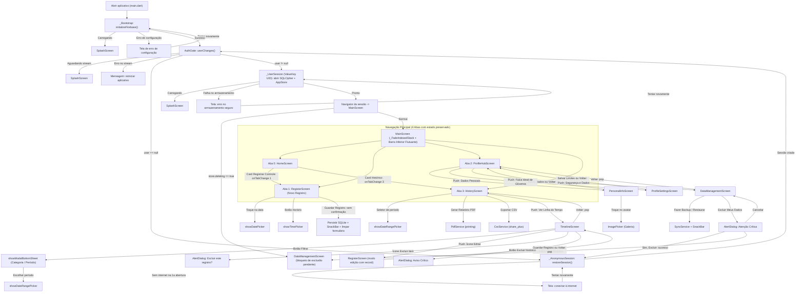

# Fluxo de Navegação Real do Aplicativo — GlicoTrack

Este documento descreve como as telas do **GlicoTrack** (`glicotrack_dev/lib/`) se conectam na prática, com base na implementação real em Flutter, cobrindo inicialização, gerenciamento de sessão automática, navegação por abas, pilhas secundárias (`Navigator.push`/`pop`), seletores nativos e diálogos de confirmação.

## 1. Visão Geral da Arquitetura de Navegação

O aplicativo organiza sua navegação em **três níveis reais**:

1. **Inicialização e Sessão (`main.dart` e `screens/auth_gate.dart`):** ao abrir o app, `_Bootstrap` inicializa o Firebase e transfere o controle para `AuthGate`. Não existe tela de login, cadastro, recuperação de senha ou logout nesta versão — a sessão Firebase é gerenciada automaticamente em segundo plano (reutilizando a sessão persistida no aparelho ou criando uma sessão anônima na primeira abertura).
2. **Navegação Principal por Abas (`screens/main_screen.dart`):** depois de abrir o banco local criptografado (`SQLCipher`) e inicializar o `AppStore` (`Provider`), `_UserSession` cria um `Navigator` próprio vinculado ao `UID` (`ValueKey(user.uid)`) tendo `MainScreen` como rota raiz. O aplicativo inicia diretamente na **Aba 1 (`RegisterScreen`)** com foco automático no campo de glicemia e abertura do teclado numérico, enquanto as 4 telas principais convivem em um `_FadeIndexedStack` controlado pela barra inferior flutuante (`_SharedBottomNavBar`), preservando estado em memória.
3. **Rotas Empilhadas e Modais:** telas secundárias e formulários de edição são abertos sobre o `Navigator` da sessão via `Navigator.of(context).push(MaterialPageRoute(...))`, com retorno padrão por `Navigator.of(context).pop()`, além de diálogos (`showDialog`), planilhas inferiores (`showModalBottomSheet`) e seletores nativos (`showDatePicker`, `showTimePicker`, `showDateRangePicker`, `ImagePicker`).

> **Isolamento por sessão:** como o `Navigator` fica abaixo de `_UserSession(key: ValueKey(user.uid))`, qualquer reinício de sessão (por exemplo, após a exclusão definitiva de dados) descarta automaticamente toda a pilha de telas da sessão anterior.

---

## 2. Diagrama do Fluxo de Navegação Real

---

## 3. Mapa Completo de Conexões entre Telas

| Tela de Origem | Arquivo | Gatilho / Ação do Usuário | Mecanismo Real no Código | Tela / Componente de Destino | Retorno / Comportamento |
| --- | --- | --- | --- | --- | --- |
| `_Bootstrap` | `lib/main.dart` | Abertura do app | `FutureBuilder` (`initializeFirebase`) | `SplashScreen` → `AuthGate` | Em caso de erro, exibe tela de configuração com botão **Tentar novamente** |
| `AuthGate` | `lib/screens/auth_gate.dart` | Verificação de sessão Firebase | `StreamBuilder<User?>` (`userChanges`) | `_AnonymousSession` ou `_UserSession` | Reutiliza sessão persistida (inclusive offline) ou cria anônima online |
| `_UserSession` | `lib/screens/auth_gate.dart` | Abertura do SQLCipher e `AppStore` | `FutureBuilder<AppStore>` + `Navigator` | `MainScreen` | Em falha local, permite **Tentar novamente**; ao mudar o UID, recria o `Navigator` |
| `MainScreen` | `lib/screens/main_screen.dart` | `store.deleting == true` | Renderização condicional no `build` | `DataManagementScreen` | Bloqueia uso normal até concluir exclusão pendente |
| `MainScreen` | `lib/screens/main_screen.dart` | Toque nos 4 ícones da barra inferior | `setState(() => _currentIndex = index)` | `HomeScreen` (0), `RegisterScreen` (1), `ProfileHubScreen` (2), `HistoryScreen` (3) | Transição `FadeTransition` (300 ms) via `_FadeIndexedStack`, instantânea se `disableAnimations` estiver ativo |
| `HomeScreen` | `lib/screens/home_screen.dart` | Card **Registrar Controle** | `widget.onTabChange!(1)` | `RegisterScreen` (Aba 1) | Alterna a aba ativa sem empilhar rota |
| `HomeScreen` | `lib/screens/home_screen.dart` | Card **Histórico** | `widget.onTabChange!(3)` | `HistoryScreen` (Aba 3) | Alterna a aba ativa sem empilhar rota |
| `RegisterScreen` (Aba 1) | `lib/screens/register_screen.dart` | Campo **Data da Medição** | `showDatePicker` | Calendário nativo | Atualiza `_selectedDate` mantendo o horário |
| `RegisterScreen` (Aba 1) | `lib/screens/register_screen.dart` | Botão **Horário** | `showTimePicker` | Seletor nativo de hora | Atualiza hora/minuto e marca `_timeChosen = true` |
| `RegisterScreen` (Aba 1) | `lib/screens/register_screen.dart` | Botão **Guardar Registro** | `store.saveRecord(record)` | Permanece na Aba 1 | Sem tela de confirmação; exibe `SnackBar`, limpa campos e refoca o campo numérico |
| `ProfileHubScreen` | `lib/screens/profile_hub_screen.dart` | Card **Dados Pessoais** | `Navigator.push` (`MaterialPageRoute`) | `PersonalInfoScreen` | Retorna à Aba 2 via botão voltar ou após **Salvar Dados** (`pop`) |
| `ProfileHubScreen` | `lib/screens/profile_hub_screen.dart` | Card **Faixa Ideal de Glicemia** | `Navigator.push` (`MaterialPageRoute`) | `ProfileSettingsScreen` | Retorna à Aba 2 via botão voltar ou após **Salvar Limites** (`pop`) |
| `ProfileHubScreen` | `lib/screens/profile_hub_screen.dart` | Card **Segurança e Dados** | `Navigator.push` (`MaterialPageRoute`) | `DataManagementScreen` | Retorna à Aba 2 via botão voltar (`pop`), salvo em estado de exclusão pendente |
| `PersonalInfoScreen` | `lib/screens/personal_info_screen.dart` | Toque na foto de perfil | `ImagePicker().pickImage` | Galeria nativa do dispositivo | Converte imagem redimensionada (até 256×256) para base64 local |
| `DataManagementScreen` | `lib/screens/data_management_screen.dart` | Botão **Excluir Meus Dados** | `showDialog` (`barrierDismissible: false`) | `AlertDialog` (**Atenção Crítica!**) | **Cancelar** fecha o modal; **Sim, Excluir** aciona `deleteAccount` e reinicia a sessão |
| `HistoryScreen` | `lib/screens/history_screen.dart` | Card do período no gráfico | `showDateRangePicker` | Seletor nativo de intervalo | Atualiza `_selectedDateRange`, gráfico `CustomPainter` e estatísticas |
| `HistoryScreen` | `lib/screens/history_screen.dart` | Botão **Gerar Relatório PDF** | `PdfService.generateMedicalReport` | Visualização/compartilhamento nativo | Gera relatório offline com os registros do período/categoria selecionados |
| `HistoryScreen` | `lib/screens/history_screen.dart` | Botão **Exportar CSV** | `CsvService.share` | Compartilhamento nativo (`share_plus`) | Exporta tabela CSV dos registros filtrados |
| `HistoryScreen` | `lib/screens/history_screen.dart` | Botão **Ver Linha do Tempo** | `Navigator.push` (`MaterialPageRoute`) | `TimelineScreen(start, end)` | Abre a lista detalhada já filtrada pelo período atual; volta via `pop` |
| `TimelineScreen` | `lib/screens/timeline_screen.dart` | Botão **Filtrar** | `showModalBottomSheet` | Menu de filtros (categoria / todo histórico / período) | **Escolher período** encadeia `showDateRangePicker` |
| `TimelineScreen` | `lib/screens/timeline_screen.dart` | Ícone **Editar registro** | `Navigator.push` (`MaterialPageRoute`) | `RegisterScreen(record: record)` | Reutiliza a tela de registro preenchida; ao salvar, executa `Navigator.pop()` |
| `TimelineScreen` | `lib/screens/timeline_screen.dart` | Ícone **Excluir registro** | `showDialog<bool>` | `AlertDialog` (**Excluir este registro?**) | Confirmação individual antes de chamar `store.deleteRecord` |
| `TimelineScreen` | `lib/screens/timeline_screen.dart` | Botão de exclusão do histórico | `showDialog<void>` (`barrierDismissible: false`) | `AlertDialog` (**Aviso Crítico**) | Confirmação antes de chamar `store.clearRecords` |

---

## 4. Comportamentos Práticos Relevantes na Navegação

### 4.1 Fluxo rápido de registro (≤ 3 interações)
- Ao acessar a Aba 1 (`RegisterScreen`) pela barra inferior ou pelo card **Registrar Controle** da `HomeScreen`, o campo de glicemia recebe foco automático (`_glucoseFocus.requestFocus()`), abrindo o teclado numérico.
- Com o teclado visível (`MediaQuery.viewInsetsOf(context).bottom > 0`), o botão **Guardar Registro** é fixado automaticamente em `Scaffold.bottomNavigationBar` acima do teclado, evitando que o usuário precise recolher o teclado para salvar.
- Não existe modal de confirmação ao salvar; a validação e a persistência no SQLite ocorrem diretamente, atualizando `HomeScreen`, `HistoryScreen` e `TimelineScreen` de forma reativa via `AppStore` (`Provider`).
- Quando o usuário sai da Aba 1 (`active: false`), o foco do teclado é liberado (`_glucoseFocus.unfocus()`) e eventuais temporizadores de alerta de hipoglicemia são cancelados.

### 4.2 Reutilização da `RegisterScreen` para criação e edição
- A mesma classe `RegisterScreen` atende tanto à criação (como aba fixa em `MainScreen`, onde `record == null`) quanto à edição (como rota empilhada via `Navigator.push` a partir de `TimelineScreen`, recebendo `record`).
- Essa distinção controla o comportamento pós-salvamento: na edição, executa `Navigator.of(context).pop()` voltando diretamente para a `TimelineScreen`; na criação, limpa os campos e mantém o formulário pronto para nova leitura.

### 4.3 Fluxo de exclusão definitiva e reinício de sessão
- Na `DataManagementScreen`, a exclusão exige confirmação explícita em diálogo não dispensável por toque externo (`barrierDismissible: false`). Em sessões anônimas, não solicita senha; caso haja conta com provedor `password` persistida, solicita a senha atual.
- Se a exclusão concluir com sucesso, o `FirebaseAuth` altera o usuário ativo, fazendo `AuthGate` desmontar o `_UserSession` anterior (junto com toda a pilha do `Navigator`) e iniciar `_AnonymousSession`.
- Se a exclusão falhar após o bloqueio local, `store.deleting` permanece `true` e `MainScreen` redireciona automaticamente para `DataManagementScreen` até que a operação seja concluída com acesso à internet.

### 4.4 Acessibilidade e desempenho na navegação
- `_FadeIndexedStack` e `SplashScreen` verificam `MediaQuery.of(context).disableAnimations`, eliminando transições animadas quando a redução de movimento está ativada no sistema operacional (WCAG AAA).
- As telas com barra inferior flutuante (`extendBody: true`) reservam espaçamento inferior (`bottom: 120.0`) e utilizam `SafeArea` + `SingleChildScrollView` para impedir que botões ou últimos cards sejam cobertos pela barra.

---

## 5. Documentos Relacionados

- [Casos de uso e visão resumida da Unidade II](fluxos-unidade-ii.md)
- [Arquitetura, SQLite e modelagem Firestore](arquitetura-unidade-ii.md)
- [Justificativas de interface e acessibilidade](justificativas.md)
- [Registro de uso de IA](uso-de-ia.md)
