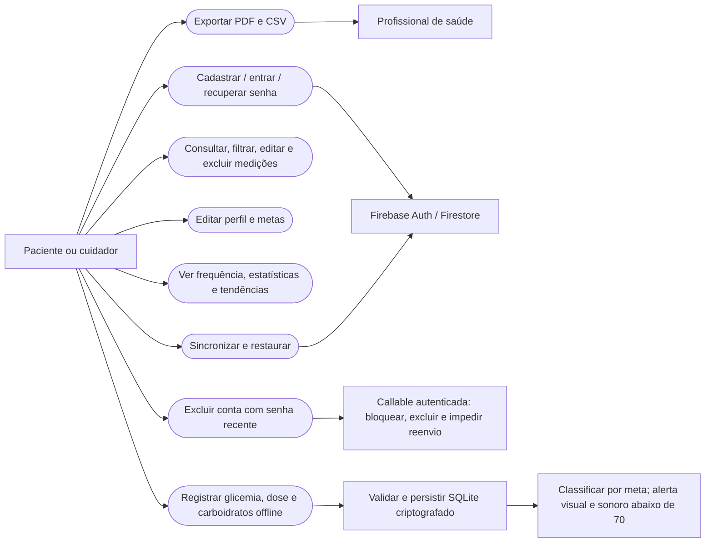
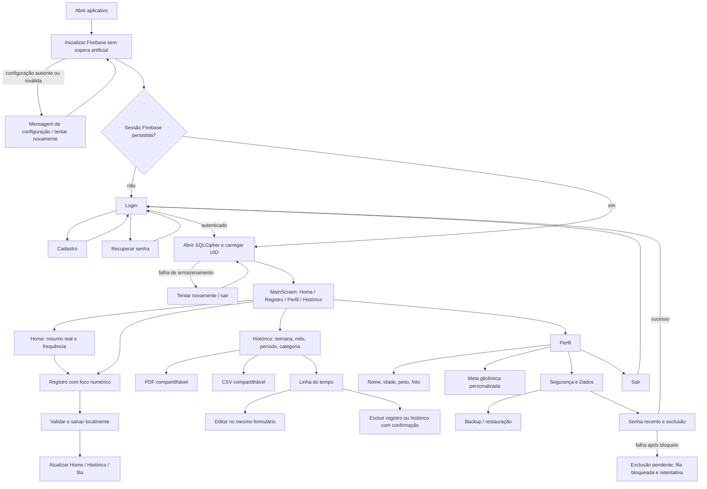

# Casos de uso e navegação - Unidade II

## Casos de uso

Paciente e cuidador usam a mesma conta responsável pelos dados; não foi implementado compartilhamento de prontuário entre contas ou um perfil de profissional com acesso remoto. O profissional recebe somente o arquivo que o paciente decide compartilhar.

## Navegação real

A Splash apenas mostra a marca enquanto inicializa. Não encaminha diretamente à MainScreen. O Navigator da conta é destruído no logout, evitando retorno a dados por meio do botão voltar.

Não há confirmação extra no salvamento. O teclado oferece ação de conclusão; com o teclado visível, o botão original de salvar aparece em área fixa para continuar acessível. Data/hora, refeição e categoria têm valores iniciais, que podem ser alterados. A fonte ampliada, cores, componentes e quatro abas permanecem alinhados ao frontend existente. O fundo da tela de registro muda conforme a classificação, além do texto explícito. A meta inferior nunca altera o limiar fixo de hipoglicemia.

Sessões anônimas criadas pela versão anterior são encaminhadas para o login. Criar conta vincula e-mail/senha ao UID existente para preservar os registros; entrar em outra conta consulta os dados dessa conta. AppBootstrap é reutilizado após a verificação da sessão, com uma única sincronização por Provider.
